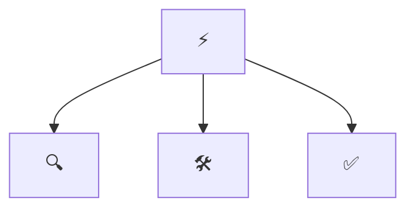

```
<ASCII banner of the repo name. Generate one with figlet or any text-to-ASCII tool>
```

<div align="center">

# ⚡ <Repo Name>

**<One line: what these skills do, for whom>**

[](https://github.com/<OWNER>/<REPO>/actions/workflows/validate.yml)
[](LICENSE)
[](https://agentskills.io)
[](https://agentskills.io/specification)
[](scripts/skills_tool.py)

</div>

> [!IMPORTANT]
> **Principle: <the single sentence every skill in this repo must obey.>**

<Two or three sentences: what problems the skills solve, what they are grounded in (official docs or authoritative sources), and that they follow the open [Agent Skills](https://agentskills.io/specification) format. Name the agents they work in, e.g. Claude Code, Codex, Cursor, Copilot, OpenCode, or any SKILL.md-compatible agent.>

## 🧩 Skills

<!-- catalogue:begin -->
| Skill | Purpose |
|---|---|
| [`example-skill`](skills/example-skill/SKILL.md) | Placeholder skill demonstrating this repository's skill format: the gate, steps, hard rule phrasing and reference layout. |
<!-- catalogue:end -->

## 🗺️ How they fit together



<One sentence on the order or priority in which the skills usually apply. Delete this section and the diagram for a repo with a single skill.>

## 📦 Install

> [!TIP]
> Install the router skill **plus every sibling skill it links to**; routers reference siblings by relative path.

Copy or symlink the `skills/` subfolders you want into your agent's skills directory:

| Agent | Where skills live |
|---|---|
| Claude Code | `~/.claude/skills/` or a project's `.claude/skills/` |
| Codex · Cursor · Copilot · OpenCode · Windsurf | the agent's own SKILL.md discovery path |

## 🚀 Usage

> [!TIP]
> **You never need to memorise skill names.** Just describe the problem in plain words; the router picks the right skill automatically. But if you want short, reliable phrases that always work, use these:

**The flow** (this is all most people need):

```text
1. "<first phrase>"     → <what happens>
2. "<second phrase>"    → <what happens>
3. "<third phrase>"     → <what happens>
```

**Short phrases that trigger each skill:**

| Just say… | What you get | Skill used |
|---|---|---|
| `<short plain phrase>` | <what happens> | *<skill>* |

> [!NOTE]
> Skills also trigger on their own when your request matches. In Claude Code you can also invoke one explicitly with `/<skill-name>`, but the plain phrases above are shorter and work across every agent.

## ✅ Validate

```bash
python scripts/skills_tool.py check
```

Checks: frontmatter, name/folder match, description length and trigger, body under 500 lines, relative links resolve, at least 3 eval cases per skill, catalogue freshness, and no em or en dashes. After the starter skill is deleted it also rejects leftover placeholders and setup scaffolding. Stdlib only, no dependencies.

## 🗂️ Layout

<details>
<summary>Repository layout</summary>

```
skills/<name>/SKILL.md      one folder per skill (+ references/ where needed)
evals/cases.jsonl           3+ behavioural cases per skill
scripts/skills_tool.py      validate, regenerate catalogue (stdlib only)
.github/workflows/          CI runs `skills_tool.py check` (free on public repos)
AGENTS.md                   agent-facing rules for this repo
SETUP.md                    fill-in checklist; delete when done
reference-content/          source material the skills are built from; delete when done
```

</details>

## 📌 Status and limits

> [!NOTE]
> - <Known limits, each dated, mirroring the "Known deliberate states" section of AGENTS.md.>
> - Licensed under MIT (see [LICENSE](LICENSE)).

---

<div align="center">

**⚡ Built on the [Agent Skills](https://agentskills.io) open format · grounded in <link to the official docs or sources>**

</div>
