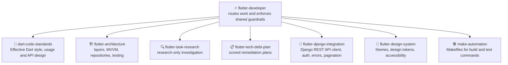

```
███████╗██╗     ██╗   ██╗████████╗████████╗███████╗██████╗
██╔════╝██║     ██║   ██║╚══██╔══╝╚══██╔══╝██╔════╝██╔══██╗
█████╗  ██║     ██║   ██║   ██║      ██║   █████╗  ██████╔╝
██╔══╝  ██║     ██║   ██║   ██║      ██║   ██╔══╝  ██╔══██╗
██║     ███████╗╚██████╔╝   ██║      ██║   ███████╗██║  ██║
╚═╝     ╚══════╝ ╚═════╝    ╚═╝      ╚═╝   ╚══════╝╚═╝  ╚═╝
██████╗ ███████╗██╗   ██╗███████╗██╗      ██████╗ ██████╗ ███████╗██████╗
██╔══██╗██╔════╝██║   ██║██╔════╝██║     ██╔═══██╗██╔══██╗██╔════╝██╔══██╗
██║  ██║█████╗  ██║   ██║█████╗  ██║     ██║   ██║██████╔╝█████╗  ██████╔╝
██║  ██║██╔══╝  ╚██╗ ██╔╝██╔══╝  ██║     ██║   ██║██╔═══╝ ██╔══╝  ██╔══██╗
██████╔╝███████╗ ╚████╔╝ ███████╗███████╗╚██████╔╝██║     ███████╗██║  ██║
╚═════╝ ╚══════╝  ╚═══╝  ╚══════╝╚══════╝ ╚═════╝ ╚═╝     ╚══════╝╚═╝  ╚═╝
```

<div align="center">

# ⚡ Flutter Developer

**Agent skills that help developers write, structure, research and maintain Dart and Flutter code to the official guidance.**

[](https://github.com/KinwiseNZ-DevOps/flutter-developer/actions/workflows/validate.yml)
[](LICENSE)
[](https://agentskills.io)
[](https://agentskills.io/specification)
[](scripts/skills_tool.py)

</div>

Table of contents:

- [Skills](#skills)
- [How they fit together](#how-they-fit-together)
- [Install](#install)
- [Usage](#usage)
- [Validate](#validate)
- [Layout](#layout)
- [Status and limits](#status-and-limits)

---

> [!IMPORTANT]
> **Principle: follow the official Dart and Flutter guidance, verify against the real code before changing it, and make the smallest correct change.**

These skills turn the Dart team's Effective Dart guide, the Flutter team's architecture and theming guidance, the Django REST Framework and Simple JWT documentation, and the GNU Make manual into short, reasoned rules an agent can apply. Each rule carries its reason, so it still works when a situation is not named. They follow the open [Agent Skills](https://agentskills.io/specification) format and work in Claude Code, Codex, Cursor, Copilot, OpenCode or any SKILL.md-compatible agent.

---

<a id="skills"></a>
## 🧩 Skills

<!-- catalogue:begin -->
| Skill | Purpose |
|---|---|
| [`dart-code-standards`](skills/dart-code-standards/SKILL.md) | Applies the official Effective Dart rules to written Dart code: identifier naming, import ordering, formatting, doc comments, null safety usage, collections, async, error handling, types, parameters, equality and public API design. |
| [`flutter-architecture`](skills/flutter-architecture/SKILL.md) | Applies the Flutter team's app architecture recommendations: UI and data layers, MVVM, repositories, unidirectional data flow, immutable models, dependency injection, navigation, naming and testing with fakes. |
| [`flutter-design-system`](skills/flutter-design-system/SKILL.md) | Applies a design system in Flutter through the theme layer: ThemeData, ColorScheme, TextTheme, ThemeExtension design tokens, light and dark themes, shared themed widgets and accessibility checks. |
| [`flutter-developer`](skills/flutter-developer/SKILL.md) | Router and shared guardrails for Dart and Flutter development work, including Django API integration and design systems: picks the right specialist skill and enforces verify-before-claiming, smallest-change and honest close-out rules. |
| [`flutter-django-integration`](skills/flutter-django-integration/SKILL.md) | Guides the Flutter side of integrating with a Django REST Framework backend: service and repository layering, OpenAPI contract and client generation, JSON model mapping, JWT authentication and token storage, error and validation mapping, pagination, environments and web CORS. |
| [`flutter-task-research`](skills/flutter-task-research/SKILL.md) | Runs a research-only investigation before a task is planned: reads the codebase and authoritative sources, records verified findings in one research note, weighs alternatives and converges on a single recommended approach without editing code. |
| [`flutter-tech-debt-plan`](skills/flutter-tech-debt-plan/SKILL.md) | Produces a scored technical debt remediation plan for Flutter and Dart code, tests and documentation, with a summary table and a detailed plan per item, without changing code. |
| [`make-automation`](skills/make-automation/SKILL.md) | Writes and reviews GNU Make Makefiles that wrap repeatable project commands such as code generation, analysis, tests and builds, covering structure, variables, phony targets, recipes, includes and portability. |
<!-- catalogue:end -->

---

<a id="how-they-fit-together"></a>
## 🗺️ How they fit together



Most work starts at the router. Research comes before a change that needs understanding, and standards and architecture apply while the change is written.

---

<a id="install"></a>
## 📦 Install

> [!TIP]
> Install the router skill **plus every sibling skill it links to**; routers reference siblings by relative path.

**Claude Code plugin** (installs the skills together):

```text
/plugin marketplace add KinwiseNZ-DevOps/flutter-developer
/plugin install flutter-developer@flutter-developer-marketplace
```

For best results also install the optional companions `flutter-optimiser` (performance) and `django-api-architect` (Django server code). The integration skill names the exact companion skill to use for each concern.

Or copy or symlink the `skills/` subfolders you want into your agent's skills directory:

| Agent | Where skills live |
|---|---|
| Claude Code | `~/.claude/skills/` or a project's `.claude/skills/` |
| Codex · Cursor · Copilot · OpenCode · Windsurf | the agent's own SKILL.md discovery path |

---

### Always on

In Claude Code, Flutter Developer loads a short ruleset into every session as soon as the plugin is installed (official Dart and Flutter guidance, smallest change, honest verification). It tells you its state at the start of each session and costs roughly 350 tokens.

| Mode | What it does |
|---|---|
| `on` (default) | The rules apply in every session |
| `auto` | The rules apply only in projects that look relevant: a Flutter `pubspec.yaml` is found |
| `off` | The rules do not load |

- Say **"stop flutter mode"** to pause it for the current session, and **"start flutter mode"** to resume.
- Ask Claude to **set the saved mode to on, off or auto**. It writes that word into `~/.claude/.flutter-developer.mode`. You can also edit that file yourself, and deleting it returns to the default (`on`).
- It needs Node on the machine, because the start-up hook runs a small Node script. Without Node the hook quietly does nothing.
- Other agents have no start-up hook here. Paste `skills/flutter-developer/references/always-on-rules.md` into that agent's instruction file instead.

<a id="usage"></a>
## 🚀 Usage

> [!TIP]
> **You never need to memorise skill names.** Just describe the problem in plain words; the router picks the right skill automatically. But if you want short, reliable phrases that always work, use these:

**The flow** (this is all most people need):

```text
1. "Research how this feature works"   → a verified research note, no code changes
2. "Make this change"                  → smallest correct change, then format, analyse and test
3. "Review this against Dart style"    → rule-by-rule findings with reasons
```

**Short phrases that trigger each skill:**

| Just say… | What you get | Skill used |
|---|---|---|
| `Where should this logic live?` | A layer decision with reasons | *flutter-architecture* |
| `Review my Dart style` | Findings against Effective Dart | *dart-code-standards* |
| `Research this before we change it` | One research note, one recommendation | *flutter-task-research* |
| `Audit tech debt in lib` | A scored remediation plan | *flutter-tech-debt-plan* |
| `Connect this screen to the Django API` | Layered client, auth, error and pagination handling | *flutter-django-integration* |
| `Apply our design tokens` | Theme and ThemeExtension wiring, accessibility checks | *flutter-design-system* |
| `Add make targets for test and analyse` | A tidy Makefile | *make-automation* |

> [!NOTE]
> Skills also trigger on their own when your request matches. In Claude Code you can also invoke one explicitly with `/flutter-developer`, but the plain phrases above are shorter and work across every agent.

---

<a id="validate"></a>
## ✅ Validate

```bash
python scripts/skills_tool.py check
```

Checks: frontmatter, name/folder match, description length and trigger, body under 500 lines, every relative link resolves (including README.md and AGENTS.md), agent profile naming with no more than two profiles per host and exactly one `-workflow` main agent, agent `skills:` entries that exist and no `skills/<name>/SKILL.md` paths in agent bodies, plugin manifests (`.claude-plugin/plugin.json` and `marketplace.json`: required fields, licence matches `LICENSE`, `agents` lists every Claude Code profile, no top-level `agents/` folder), at least 3 eval cases per skill, catalogue freshness, no project-specific terms from `reference-content/strip-terms.txt`, and no em or en dashes in file names or in any text outside `reference-content/`. After the starter skill is deleted it also rejects leftover placeholders and setup-only paths that are tracked by Git or not ignored. Stdlib only, no dependencies.

---

<a id="layout"></a>
## 🗂️ Layout

<details>
<summary>Repository layout</summary>

```
skills/<name>/SKILL.md      one folder per skill (+ references/ where needed)
.claude-plugin/             plugin.json and marketplace.json (Claude Code plugin)
hooks/                      always-on start-up hook for Claude Code
evals/cases.jsonl           3+ behavioural cases per skill
resources/agents/           optional host profiles copied by installer
scripts/install_agents.py   copy optional agent profiles into a project
scripts/skills_tool.py      validate, regenerate catalogue (stdlib only)
.github/workflows/          CI runs `skills_tool.py check` (free on public repos)
AGENTS.md                   agent-facing rules for this repo
```

</details>

---

<a id="status-and-limits"></a>
## 📌 Status and limits

> [!NOTE]
> - Architecture advice keeps the Flutter team's priority labels (Strongly recommend, Recommend, Conditional) and is meant to be adapted, not applied blindly.
> - The Django integration skill covers the Flutter client only; server code belongs to the backend. Advice not stated by an official page is marked as inference in the skill references.
> - Performance profiling and optimisation are out of scope here. The skills hand off to the `flutter-optimiser` plugin (flutter-performance-specialist) and, for server code, to the `django-api-architect` plugin, when those are installed. Without them the skills still work and say the hand-off was skipped.
> - No agent profiles are supplied yet; the skills run directly in any compatible agent.
> - Licensed under MIT (see [LICENSE](LICENSE)).

---

<div align="center">

**⚡ Built on the [Agent Skills](https://agentskills.io) open format · grounded in [Effective Dart](https://dart.dev/effective-dart) and the [Flutter architecture guide](https://docs.flutter.dev/app-architecture)**

</div>
